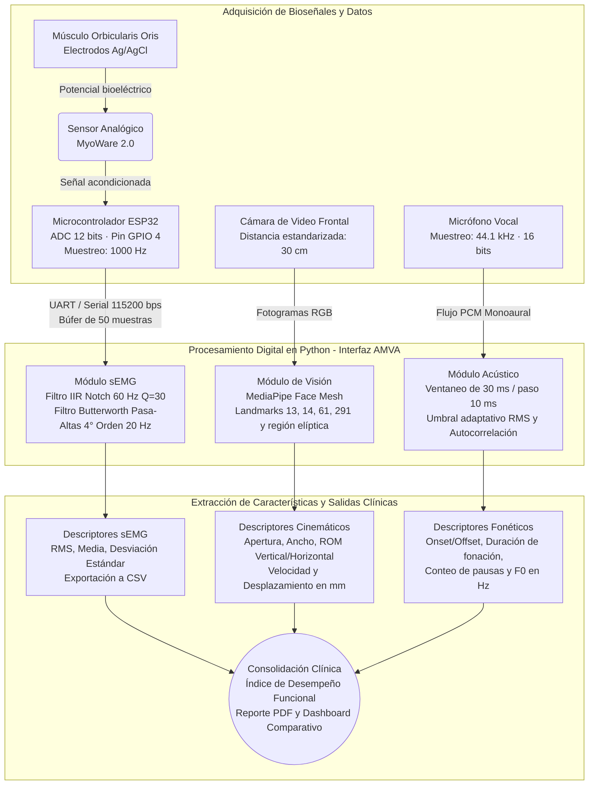

# AMVA-Sistema-Multimodal
Sistema multimodal (sEMG, visión por computadora y análisis acústico) para el apoyo en la evaluación clínica de terapias de rehabilitación oral.
# AMVA: Sistema Multimodal para Apoyo en Terapias de Rehabilitación Oral

**Centro Universitario de Ciencias Exactas e Ingenierías (CUCEI) — Universidad de Guadalajara**  
**Licenciatura en Ingeniería Biomédica**

**Autoras:**  
* América Valentina Moreno Cruz (`america.moreno3998@alumnos.udg.mx`)  
* Valeria Correa Esquivel (`valeria.correa2858@alumnos.udg.mx`)  

**Asesores:**  
* Dr. Ricardo Antonio Salido Ruiz (`ricardo.salido@academicos.udg.mx`)  
* Mtro. Ricardo Emmanuel García Manzo (`emmanuel.garcia@academicos.udg.mx`)  

---

## Descripción General

**AMVA** es un sistema de instrumentación y procesamiento biomédico diseñado para proporcionar métricas objetivas y cuantificables durante la evaluación funcional del sistema estomatognático, enfocándose particularmente en la biomecánica del músculo orbicular de los labios (*orbicularis oris*) en pacientes con trastornos miofuncionales orofaciales (TMO) y dislalia.

El sistema centraliza en una interfaz gráfica de usuario (GUI) desarrollada en Python la adquisición y el procesamiento de tres modalidades:
1. **Electromiografía de Superficie (sEMG):** Registro de un canal sobre el músculo orbicular de los labios para cuantificar niveles de activación muscular, reclutamiento motor y esfuerzo mediante métricas en el dominio temporal y frecuencial.
2. **Visión por Computadora (Cinemática Facial):** Seguimiento perioral sin marcadores físicos mediante *MediaPipe Face Mesh*, calculando distancias inter-comisurales, apertura labial, rangos de movimiento (ROM) y velocidades de desplazamiento con conversión métrica calibrada (mm).
3. **Análisis Acústico de la Fonación:** Captura de voz sincronizada con detección automatizada de actividad vocal (inicio, término, duración de fonación, conteo de pausas) y estimación de la frecuencia fundamental ($F_0$) mediante autocorrelación.

---

## Arquitectura del Sistema y Flujo de Señales

A continuación se presenta la arquitectura general de interconexión de hardware y los bloques de procesamiento digital implementados en el software central:



---

## Especificaciones Técnicas por Módulo

### 1. Módulo de Adquisición y Procesamiento sEMG
* **Hardware de captura:** Sensor de electromiografía superficial MyoWare 2.0 acoplado al pin analógico `GPIO 4` de un microcontrolador ESP32.
* **Configuración del ADC y muestreo:** Resolución configurada a 12 bits con atenuación de 11 dB (`ADC_11db`). El muestreo se ejecuta mediante control estricto por temporizador en microsegundos (`SAMPLE_INTERVAL = 1000 µs`), garantizando una frecuencia de muestreo ($f_s$) constante de **1000 Hz** sin deriva temporal (*drift*). Las lecturas se empaquetan en un búfer de 50 muestras antes de transmitirse por puerto serie a **115200 baudios**.
* **Filtrado digital (SciPy):** 
  * Filtro **IIR Notch** a $60\text{ Hz}$ ($Q = 30.0$) con fase cero (`filtfilt`) para suprimir la interferencia de la red eléctrica.
  * Filtro **Butterworth pasa-altas** de 4° orden con frecuencia de corte en $20\text{ Hz}$ (`filtfilt`) para eliminar artefactos de movimiento y fluctuaciones de la línea base.

### 2. Módulo de Visión por Computadora y Calibración Espacial
* **Seguimiento anatómico:** Basado en la malla de 468 puntos de *MediaPipe Face Mesh* (`refine_landmarks=True`, confianza mínima de detección y seguimiento de `0.6`).
* **Puntos de interés primarios:**
  * **Apertura bucal vertical:** Distancia euclidiana entre el borde libre del labio superior (`landmark 13`) y el labio inferior (`landmark 14`).
  * **Ancho intercomisural:** Distancia euclidiana entre la comisura labial izquierda (`landmark 61`) y la comisura derecha (`landmark 291`).
  * **Región perioral dinámica:** Selección automática de puntos dentro de una máscara elíptica adaptativa escalada en función del ancho bucal (`factor_ancho = 1.75`, `factor_alto = 1.35`) delimitada verticalmente entre la base nasal (`landmark 1`) y el mentón (`landmark 152`).
* **Calibración métrica:** Estandarizando la postura del sujeto a **30 cm** de la cámara (con apoyo de guía elíptica en pantalla), se estableció una relación física de referencia de $50\text{ mm} \equiv 83.462\text{ px}$, aplicando un factor de conversión constante de **$0.599078\text{ mm/px}$** para expresar todas las variables espaciales y cinemáticas en milímetros.

### 3. Módulo de Procesamiento Acústico
* **Parámetros de grabación:** Captura mediante `sounddevice` a $44100\text{ Hz}$, 1 canal (mono) en formato PCM de 16 bits (`int16`), almacenando los registros crudos en formato `.wav`.
* **Segmentación temporal y extracción de $F_0$:**
  * Análisis por ventanas deslizantes de $30\text{ ms}$ con desplazamientos (*step*) de $10\text{ ms}$.
  * Detección de inicio (*onset*) y fin (*offset*) de la emisión sonora mediante un umbral adaptativo calculado a partir del piso de ruido (percentil 20 del RMS) y el percentil 75 de energía. Se contabilizan como pausas intrafonatorias las caídas de actividad mayores o iguales a $0.15\text{ s}$.
  * Estimación de la frecuencia fundamental ($F_0$) en segmentos activos dentro del rango vocal humano ($70\text{ Hz} - 400\text{ Hz}$) aplicando ventana de Hanning y búsqueda de picos en la función de autocorrelación normalizada con interpolación parabólica.

---

## Protocolo Experimental de Evaluación (6 Etapas)

El software guía al especialista y al participante a través de seis etapas secuenciales diseñadas bajo criterios de evaluación miofuncional orofacial:

| Etapa | Tarea Clínica | Descripción de la Maniobra | Duración / Repeticiones |
| :--- | :--- | :--- | :--- |
| **Etapa 1** | **Sellado Labial** | Mantener los labios en contacto estático sin forzar la contracción para evaluar competencia y estabilidad postural. | 10 segundos (1 ciclo) |
| **Etapa 2** | **Fuerza Labial** | Ejercicio de resistencia isométrica sosteniendo un abatelenguas con la musculatura labial. | 5 segundos × 5 repeticiones (5 ciclos) |
| **Etapa 3** | **Coordinación** | Transición motora continua alternando gestos de retracción comisural (sonrisa) y protrusión labial (beso). | 10 ciclos continuos |
| **Etapa 4** | **Fonemas Bilabiales** | Emisión de sílabas oclusivas y nasales bilabiales (`/pa/`, `/ba/`, `/ma/`) que requieren cierre hermético previo a la liberación acústica. | 10 repeticiones por fonema (3 ciclos) |
| **Etapa 5** | **Palabras Funcionales** | Articulación de vocablos con carga fonética bilabial (*Mapa, Bebé, Bomba*). | 10 repeticiones por palabra (3 ciclos) |
| **Etapa 6** | **Frases** | Producción de oraciones continuas (*"Mi mamá me mima"*, *"Papá toma sopa"*, *"Mi bebé toma biberón"*). | 1 ciclo completo |

---

## Estructura del Repositorio y Archivos Generados

```text
AMVA-Sistema-Multimodal/
│
├── Interfaz Final.py                     # Aplicación principal (GUI, procesamiento multimodal y reportes)
├── logo_amva.jpeg                        # Logotipo institucional cargado en el encabezado de la interfaz
├── requirements.txt                      # Dependencias del entorno de Python
├── README.md                             # Documentación técnica del sistema
│
├── firmware/
│   └── adquisicion_semg_esp32/
│       └── adquisicion_semg_esp32.ino    # Firmware de muestreo a 1000 Hz para ESP32
│
└── AMVA_resultados/                      # Directorio autogenerado durante las sesiones clínicas
    └── Sujeto_XX/
        ├── Audio/
        │   └── Sujeto_XX_Etapa_N.wav                  # Registros acústicos por etapa
        ├── Datos/
        │   ├── Video_parametros_por_frame.csv         # Serie temporal cinemática cuadro por cuadro
        │   ├── Video_parametros_resumen.csv           # Estadísticos de apertura, ancho, ROM y velocidad
        │   └── Audio_parametros.csv                   # Tiempos de fonación, pausas y frecuencia fundamental
        ├── sEMG/
        │   └── Etapa_N_sEMG.csv                       # Señal cruda y filtrada muestreada a 1000 Hz
        └── Reporte_Clinico_Sujeto_XX.pdf              # Reporte consolidado generado con ReportLab
```

---

## Instalación y Puesta en Marcha

### 1. Requisitos Previos
* **Python 3.9 a 3.11** (recomendado para compatibilidad con los binarios de MediaPipe).
* **Arduino IDE** (con soporte para placas *ESP32 by Espressif Systems* instalado).
* Cámara web integrada o USB y micrófono funcional configurados en el sistema operativo.

### 2. Configuración del Entorno en Python
Clona este repositorio e instala las librerías necesarias ejecutando en la terminal:

```bash
git clone [https://github.com/america082/AMVA-Sistema-Multimodal.git](https://github.com/TU_USUARIO/AMVA-Sistema-Multimodal.git)
cd AMVA-Sistema-Multimodal
pip install -r requirements.txt
```

### 3. Carga del Firmware en el ESP32
1. Abre el archivo `firmware/adquisicion_semg_esp32/adquisicion_semg_esp32.ino` en Arduino IDE.
2. Conecta la salida analógica (`ENV` o `RAW`) del sensor **MyoWare 2.0** al pin **GPIO 4** del ESP32, compartiendo tierra (`GND`) y alimentación (`3.3V`).
3. Selecciona tu placa ESP32 y el puerto COM correspondiente, y sube el programa.
4. Verifica el puerto asignado en el Administrador de Dispositivos de Windows (por defecto el script apunta a `COM5` en el atributo `self.semg_puerto = "COM5"` dentro de `Interfaz Final.py`; modifícalo si tu equipo asigna otro puerto).

### 4. Ejecución de la Interfaz
Para iniciar el sistema, ejecuta desde la carpeta raíz:

```bash
python "Interfaz Final.py"
```

---

## Funcionalidades de Análisis y Reporte Clínico

* **Reproducción Cinemática Perioral:** Con el fin de resguardar la privacidad e identidad facial del paciente, el sistema **no almacena videos ni fotografías del rostro**. En su lugar, permite reconstruir y animar en un lienzo vectorial el movimiento exacto de los puntos de la región orbicular a partir de las coordenadas normalizadas extraídas durante la prueba.
* **Centro de Análisis y Dashboard Comparativo Multisujeto:** Cuenta con un módulo de graficación para inspeccionar las curvas de apertura, ancho, velocidad y sEMG filtrada por etapa, así como un *Dashboard Comparativo* que permite superponer múltiples registros sEMG (aplicando un desplazamiento vertical u *offset* por carril y recortando artefactos de cierre) junto con gráficas de barras del valor RMS y su error estándar.
* **Índice de Desempeño Funcional y Exportación a PDF:** Al finalizar las 6 etapas (o al cargar el expediente histórico de un sujeto desde disco), el sistema calcula un puntaje ponderado sobre 100 puntos dividido en cuatro rubros clínicos:
  1. *Postura y Sellado Labial (20%)*
  2. *Movilidad y Simetría Global — ROM (30%)*
  3. *Fuerza del Orbicular Consolidada — sEMG (35%)*
  4. *Control Fonético y Articulatorio General (15%)*  
  El dictamen se exporta directamente a un documento `.pdf` estructurado listo para impresión o archivo clínico.

---

## Consideraciones Éticas y de Privacidad
El protocolo de adquisición y el software AMVA fueron diseñados bajo los lineamientos de investigación de riesgo mínimo (Artículo 17 del Reglamento de la Ley General de Salud en Materia de Investigación para la Salud y Declaración de Helsinki). Todos los registros generados se indexan exclusivamente mediante identificadores alfanuméricos (`Sujeto_XX`), omitiendo el almacenamiento de imágenes faciales crudas.
